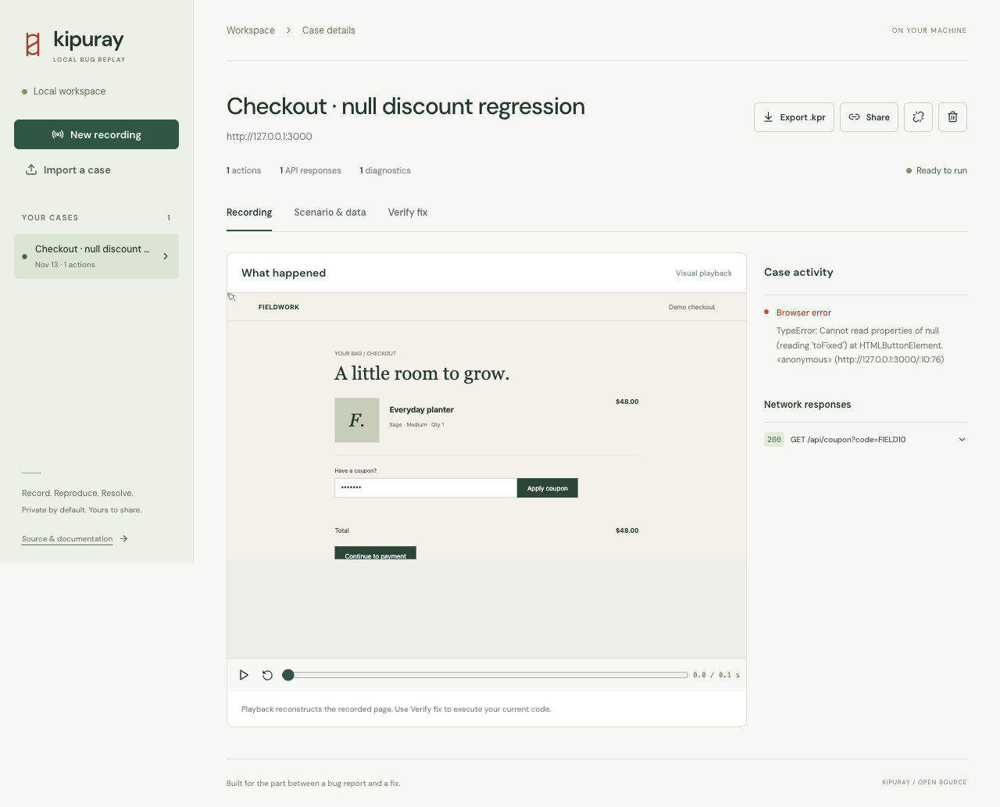
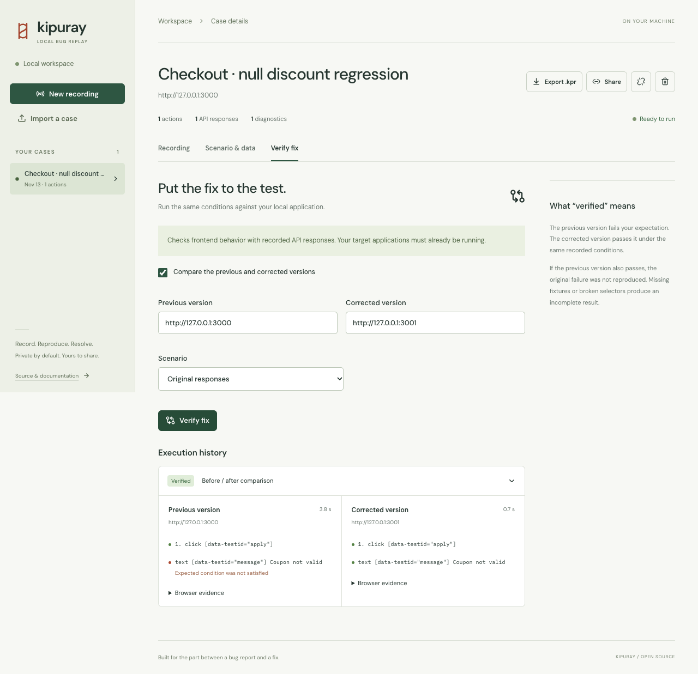

# Kipuray

**Record a bug. Reproduce its conditions. Verify the fix on localhost.**

Kipuray turns a short browser session into a portable `.kpr` case: visual evidence,
recorded interactions, JSON API fixtures, and an explicit expected result. Open
the case offline, run it against your current frontend, or compare the broken and
corrected versions with the same conditions.

A Go binary serves the complete interface. No cloud account, application SDK, or
external database is needed for the supported local workflow.

**Start here:** [Test your own application](docs/local-development.md) ·
[Install](#install) · [Try the bundled demo](#try-the-bundled-demo) ·
[Troubleshooting](docs/local-development.md#troubleshooting)

## Record your application

1. [Download the right binary](docs/local-development.md#1-install-the-right-binary)
   for your OS/CPU and install Chrome/Chromium. Rename the executable to `kipuray`
   (`kipuray.exe` on Windows).
2. Start your own application and its test backend in one terminal. For v0.1,
   use a local build/preview or a mode **without HMR WebSockets**.
3. In another terminal, start Kipuray with your application's URL:

   ```sh
   ./kipuray dev http://127.0.0.1:4173/checkout --capture-json
   ```

4. Confirm **Application URL** and **Include JSON API payloads** using synthetic
   data. Click **Open recording window**, reproduce the bug in that window,
   then return to the workspace and click **Stop & review**.
5. In **Scenario & data**, replace masked input values with test data, review the
   API fixtures, add the correct **Expected result**, and click **Save case**.
6. Open **Verify fix**. For one target, uncheck **Compare the previous and corrected
   versions**, enter your app's URL, and click **Run scenario**. After changing your
   code, rebuild/restart the app and run the same case again. To verify a correction
   between two running versions, enable the comparison and set both URLs.

Kipuray serves its workspace on port **4317**; your application keeps its own
port. Keep both terminals open. No application SDK or Kipuray source checkout is
required. Start with an authentication-independent test page: fresh browser profiles
do not inherit your usual login or storage. Windows PowerShell users should use `.\kipuray.exe` instead of `./kipuray`.

**[Follow the complete local-development walkthrough](docs/local-development.md)**
for OS/CPU selection, an existing Vite app example, selectors/expectations,
before/after setup, response variants, portable files, and troubleshooting.



[Watch the recorded browser walkthrough](docs/images/demo.webm).

## Install

Download the binary for your operating system and architecture from
[Releases](https://github.com/keynertyc/kipuray/releases/latest), rename it to
`kipuray` (`kipuray.exe` on Windows), and run:

```sh
# macOS / Linux: make the downloaded file executable first.
chmod +x kipuray
./kipuray demo
```

On Windows PowerShell, run `.\kipuray.exe demo`. Chrome/Chromium is needed for recording and
execution. The release includes SHA-256 checksums and license notices.

Choose `darwin_arm64` for an Apple Silicon Mac and `darwin_amd64` for an Intel Mac.
The [installation table](docs/local-development.md#1-install-the-right-binary)
covers Linux and Windows as well.

### Try the bundled demo

After `./kipuray demo` starts, open the workspace at `http://127.0.0.1:4317` if it
does not open automatically. The generated checkout case is already recorded:

1. Open **Recording** to inspect the browser evidence.
2. Open **Scenario & data** to inspect the action, API fixture, and expected result.
3. Open **Verify fix** and click **Verify fix** with the supplied URLs.

The previous checkout on port **3000** should fail, the corrected checkout on
**3001** should pass, and the comparison should show **Verified**. Stop the demo
with **Ctrl+C** before using those ports for your own application.

### Build from source

Requirements for a source build: **Go 1.27.4+, Node.js 22.12+ or 24+, npm, and
Chrome/Chromium**. Node and Go are build tools; users of a compiled binary only
need the browser for recording and execution.

```sh
git clone https://github.com/keynertyc/kipuray.git
cd kipuray
make build
./bin/kipuray demo
```

The demo starts a broken checkout on port **3000**, a corrected checkout on
**3001**, and the workspace on **4317**. It records a genuine browser case using
synthetic data, then opens it in your browser. Go to **Verify fix** and click
**Verify fix**. The previous version fails the expected result; the corrected
version passes.

Both versions receive `discount: null`. The correction handles that state rather
than calling `.toFixed()` on it. The demo does not make purchases or contact an
external API.

For a browser installed outside standard locations, add `--chrome /path/to/chrome`.
You can check that exact executable with `kipuray doctor --chrome /path/to/chrome`.
Use `--no-open` on any workspace command to print the URL without opening it.

Source builds are available now. The [release workflow](.github/workflows/release.yml)
packages standalone binaries and SHA-256 checksums when a version tag is published.
Cross-compilation targets macOS, Linux, and Windows on amd64 and arm64; browser
compatibility still depends on an installed Chromium distribution for that platform.

## Three connected tools

**A portable, executable case.** Export a recording, inspect it on another machine,
and replay its interactions against a local frontend with the recorded API
responses. Visual playback and executing current application code are distinct
actions in the interface.

**Response variants.** Keep the original fixture and create an alternative JSON
body, HTTP status, or delay for one recorded occurrence. Check empty states,
unexpected values, and unavailable services from the same case.

**Before/after verification.** Use the same functional expectation against two
local versions. A failed expectation followed by a passing one is reported as
verified for that scenario. A missing fixture, interrupted recording, or broken
action produces an incomplete result.



## Capture and test data

Inputs are masked by default. Passwords, cookies, and authorization headers are
not exported. An input explicitly marked `data-kipuray-public` may contribute its
value to executable actions; only use that marker for public synthetic values.
Use `data-kipuray-block` or `data-private` to exclude a DOM subtree and
`data-kipuray-mask` to mask text. Page content and diagnostic messages still need
human review before sharing. See [data handling](docs/data-handling.md).

## CLI and CI

```sh
kipuray doctor
kipuray open checkout.kpr
kipuray run checkout.kpr --target http://127.0.0.1:3001
kipuray compare checkout.kpr \
  --before http://127.0.0.1:3000 \
  --after http://127.0.0.1:3001 \
  --format junit --output result.xml
```

`run` and `compare` support `--variant ID`, `--chrome PATH`, and JSON, JUnit, or
HTML reports. The target applications must already be running. Imported cases
never start shell commands or applications.

| Exit code | Meaning                                                                       |
| --------- | ----------------------------------------------------------------------------- |
| `0`       | Scenario passed, or comparison verified the fix                               |
| `1`       | Expectation failed, regression, still failing, or original bug not reproduced |
| `2`       | Incomplete scenario, invalid input, or operational error                      |

A single passing execution is labeled **passed**. A comparison is **verified**
only when the previous version fails and the corrected version passes. If both
pass, the result is **not reproduced**.

## Share on your server

The sharing server stores cases and serves the viewer. Recording and execution
stay on developer workstations or in their CI; the server does not need Chrome.

```sh
# Generate a private owner token; keep it outside source control.
export KIPURAY_TOKEN="$(openssl rand -hex 32)"
kipuray serve --listen 0.0.0.0:4317 --data-dir ./data --no-open
```

Alternatively, set `KIPURAY_TOKEN` and run `docker compose up --build -d`.
The supplied Compose file binds port 4317 to the host's loopback interface and
persists data in a named volume. Sign in with the configured owner token.

For access over the Internet, put the server behind an HTTPS reverse proxy.
Sharing creates read-only links that expire after 24 hours; the owner can revoke
all links for a case. A shared link exposes the case's recorded data to anyone
who holds it, so review the case first. See [hosting](docs/hosting.md).

## Supported scope

This first version targets a **single Chromium tab**, conventional DOM forms,
clicks and input changes, and finite JSON Fetch/XHR APIs. Execution is restricted
to `localhost` and loopback URLs. Requests consume fixtures by method, canonical
path/query/body, origin identity, and occurrence.

- Fixture-based runs verify **frontend behavior**. They do not verify real backend
  writes, migrations, or external services.
- The dedicated browser uses a fresh profile. It does not inherit your normal
  login. Cases do not carry cookies or browser storage.
- Visual playback uses captured DOM and inline styles in an isolated viewer.
  External images/fonts and other unavailable resources may appear blank; the
  viewer does not retrieve them to complete a recording.
- WebSocket/SSE, service-worker-dependent apps, multiple windows, cross-origin
  iframes, canvas/video, and native mobile apps are outside the supported scope.
- This is action and fixture replay, not deterministic JavaScript runtime replay.
  Timing-sensitive races are not deterministic; captures with concurrent identical API calls are marked non-executable.

Captures have a ten-minute timeout, a bounded recording budget, and a 64 MiB
portable-case limit. Local workspaces checkpoint active captures every three
seconds; after a crash, incomplete recordings remain inspectable. Recapture an
interrupted or truncated scenario before executing it.

## Contribute

```sh
make build              # compile web assets, recorder, and binary
make test check         # race tests, vet, types, formatting
make browser-test       # real Chrome capture, archive roundtrip, fixtures, variants
make ui-test            # complete UI journey using the bundled demo
```

Build assets before Go tests on a fresh checkout. After frontend edits, run
`npm run format --prefix web` and rebuild the binary. Use a separate data directory
while developing, for example `./bin/kipuray demo --data-dir /tmp/kipuray-dev`.

Read [the architecture](docs/architecture.md), [the portable format](docs/case-format.md),
and [AGENTS.md](AGENTS.md) for the module boundaries and checks.
See [the changelog](CHANGELOG.md) for fixes in each release. Report compatibility
issues with a minimal synthetic case and your browser/OS versions.

## Name and license

The Peruvian Ministry of Education's Southern Quechua vocabulary records
_kipuray/khipuray_ as “registrar datos” (record data).
[Source](https://repositorio.minedu.gob.pe/handle/20.500.12799/7490).

Kipuray is licensed under [Apache-2.0](LICENSE). The project builds on rrweb,
chromedp, SQLite, React, and other open-source work; see [third-party notices](NOTICE).
