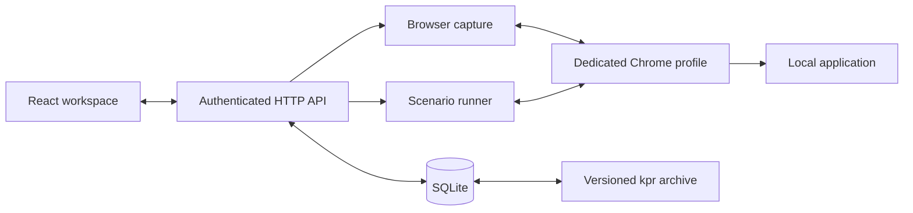

# Architecture

Kipuray is a modular Go monolith. Its embedded React interface talks to a same-origin
HTTP API; a dedicated Chromium process performs capture and execution. SQLite
stores validated case documents, run evidence, and hashes of revocable sharing tokens.

## Module boundaries

`casefile` defines the portable contract, structural limits, integrity validation,
and readiness checks. It has no browser or storage dependency. The archive is data,
not an executable test script.

`browser` owns Chromium lifecycle and typed CDP commands. The recorder receives
DOM evidence through a runtime binding. The runner interprets a small declarative
action vocabulary and checks explicit expectations. Request fixtures retain
origin identity; the original frontend origin is remapped to the chosen target.
Responses are consumed in occurrence order. Missing or unused fixtures make a
run incomplete.

`store` persists case documents transactionally in SQLite with WAL and a bounded
connection pool. This favors a simple single-process deployment. It does not
provide distributed writes or shared network-filesystem coordination.

`httpapi` authenticates requests, enforces local/remote capabilities, serializes
browser operations, checkpoints recordings, and serves embedded assets.
`report` renders JSON, HTML, and JUnit outputs without coupling them to HTTP.

The web interface separates case state, fixture editing, evidence rendering,
capture setup, and the replay frame. rrweb is loaded lazily for playback.
Fonts and scripts are shipped with the application; no CDN is required.

## Execution semantics

Every run creates a fresh browser profile and uses the recorded viewport. Frontend
documents and assets load from the approved local target. API calls receive
fixtures; they do not fall through to the live backend when a fixture is absent.
External resources are blocked. No shell command is read from a case.

An action failure is an incomplete execution. An unsatisfied functional
expectation is a failed run. A successful run means the recorded scenario's
expectations passed; it is not evidence about all application behavior.

The runner waits for HTTP requests and fixture fulfillment to finish, followed by
a 200 ms quiet period, before evaluating expectations. It observes the network
again after functional checks and evaluates `no-errors` last. These waits use the
overall 90-second run deadline, including configured response delays. They do not
control arbitrary future timers or guarantee deterministic JavaScript scheduling.

The before/after comparison uses the same case and variant sequentially. It
reports a verified correction only for a failed expectation followed by a pass.

## Playback boundary

Visual playback reconstructs the recorded DOM rather than re-executing original
application scripts. It lives in a separate frame with a restrictive content
security policy; rrweb reconstructs into its own sandboxed frame. Canvas replay
is disabled. External image/font resources are not fetched.

## Operational limits

One workspace process coordinates one browser operation at a time. Capture times
out after ten minutes and retains a bounded amount of data. The archive is capped
at 64 MiB expanded and compressed. Active recordings are checkpointed every three
seconds; they remain marked as interrupted if the process exits before finalizing.

Case deletion also removes its execution history and sharing links. Deletion is
logical database deletion; it is not a secure-erasure guarantee. Back up the
database consistently as described in the hosting guide.
